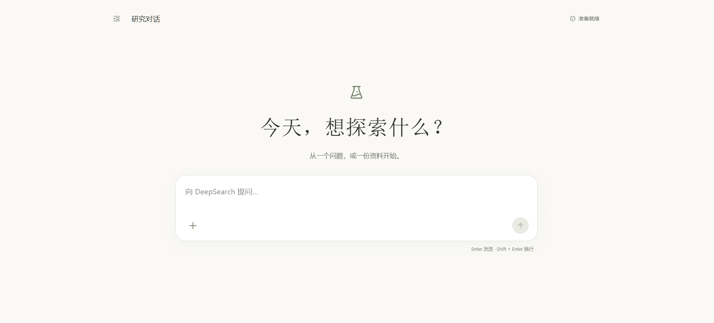
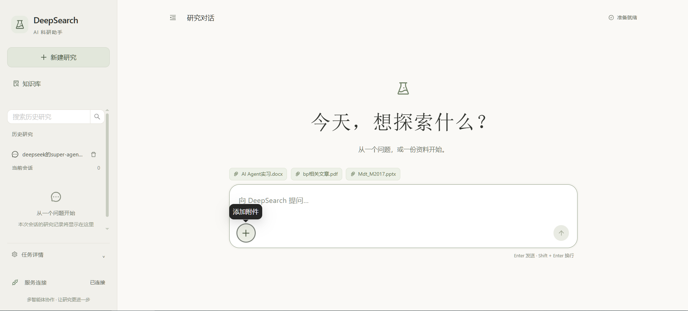
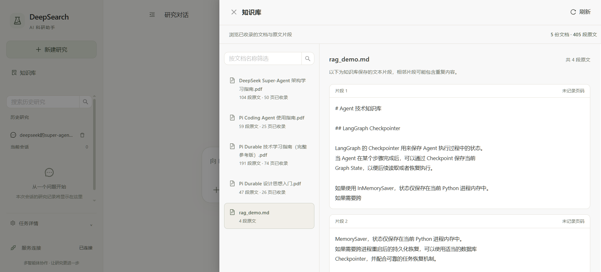
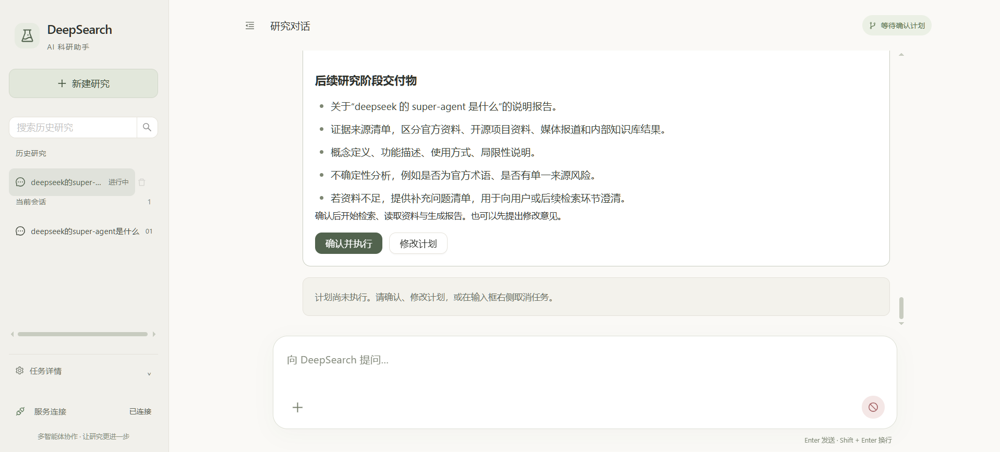
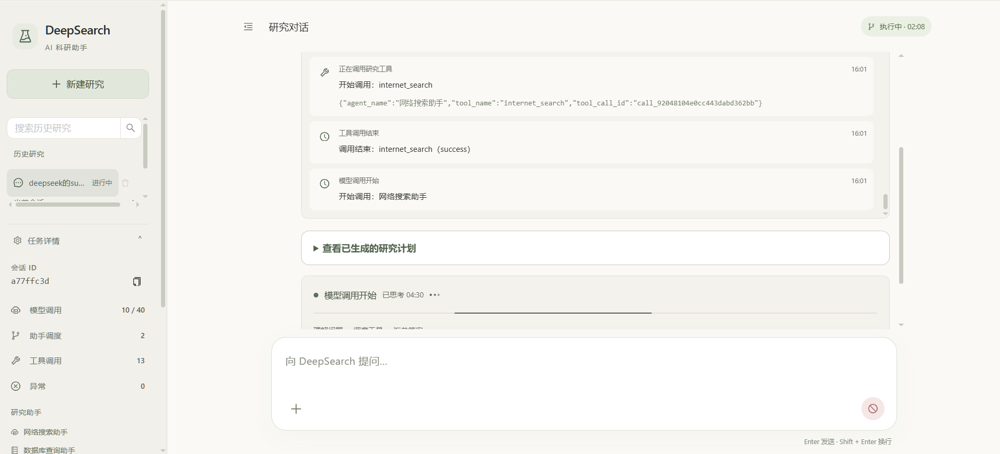
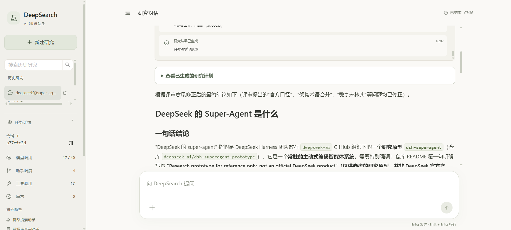
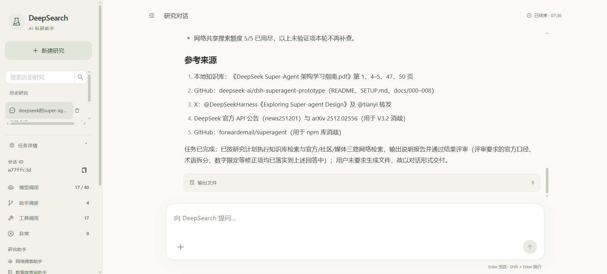
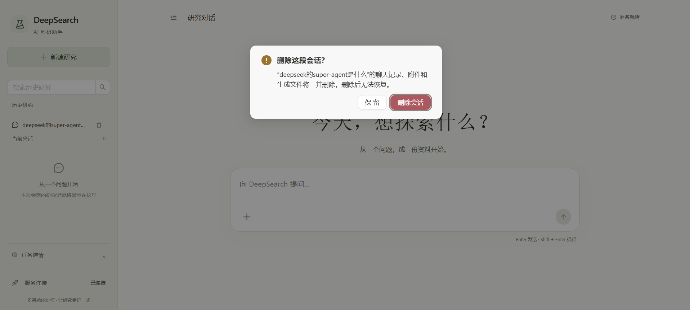
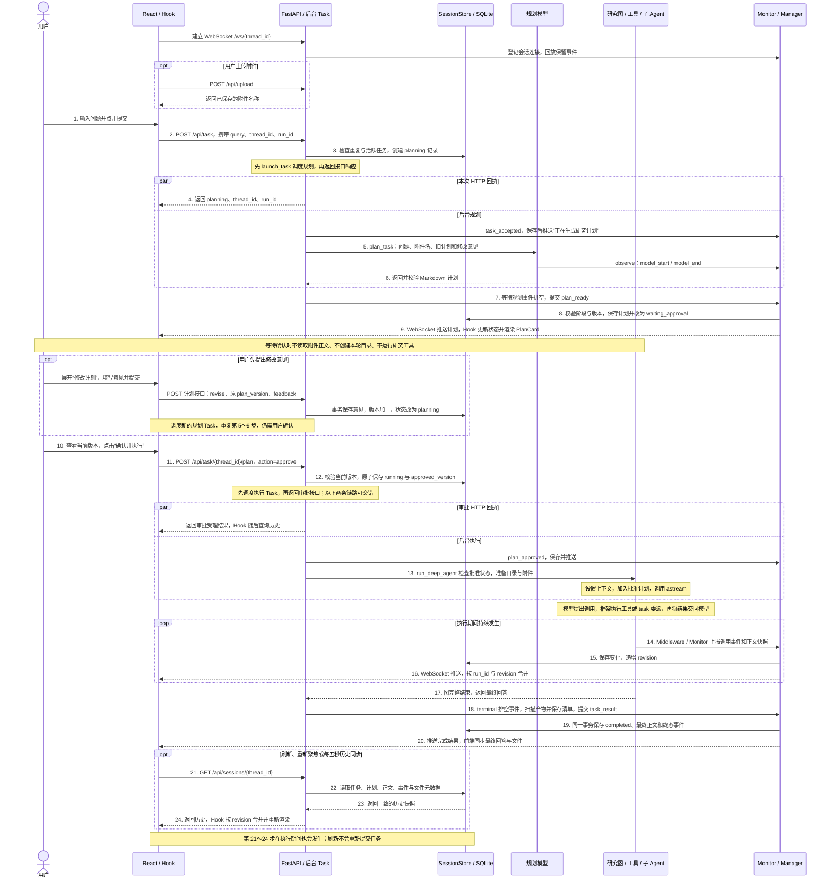

# 研序 · 多智能体研究工作台

> 让研究从一个问题，有序走向有据可查的结论。

研序（YanXu）是一个运行在本机的多智能体研究工作台。你可以提出研究问题、上传资料，先查看系统给出的计划，确认后再让 Agent 搜索网页、查询数据库、检索知识库或整理文档。研究进展会显示在聊天页面中，完成后可以阅读答案、查看来源并下载报告。

“研”代表研究与资料分析，“序”代表先规划、再执行、最后汇总的有序流程。

## 项目背景

这个项目的出发点，是想学习 ChatGPT 等网页 AI 聊天工具的交互方式，并尝试自己搭建一个可以实际使用的 AI 应用。通过实现问题输入、附件上传、回答展示和历史会话管理，理解聊天页面如何与后端模型调用、任务状态和数据存储配合。

在此基础上，希望把它用于更具体的资料调研场景。例如，了解一项新技术时，往往需要查阅网页、阅读本地文档、检索知识库，再把不同来源的信息核对、整理成结论。这类任务涉及多个步骤，除了最终答案，也需要能够提前确认研究方向，并在执行中了解进展。

因此，研序在已有多智能体研究框架上进行二次开发，将聊天交互与研究计划确认、专家协作、执行过程展示和报告交付结合起来，在实践中学习一个多智能体研究应用从前端到后端的完整实现。

## 项目目标

让用户从提出问题、确认研究计划，到查看执行过程、获取答案和报告，在同一个聊天页面内完成研究流程。围绕这一目标，重点完善以下能力：

- **研究方向确认**：开始执行前展示计划，支持用户提出修改意见并确认当前版本。
- **多源资料协作处理**：由主 Agent 调度不同专家，结合网页、数据库、知识库和附件形成回答。
- **执行过程可查看、可控制**：展示调用与任务状态，支持取消、历史查询和刷新后同步进度，并限制调用预算、并发和超时。
- **研究结果交付**：保留回答、来源和输出文件，支持按需下载 Markdown / PDF 报告。

## 界面预览

下面按一次研究任务的使用流程，展示从提出问题、准备资料到查看结果和管理会话的主要界面。

### 1. 研究首页

从一个问题或一份资料开始，在输入框中提出研究需求。



### 2. 上传附件

通过输入框旁的添加附件入口选择本地资料，已添加的附件显示在输入框上方。



### 3. 知识库预览

查看知识库已收录的文档，按文档名称筛选，并选择文档查看已收录的原文片段。



### 4. 研究计划确认

执行前先查看研究计划与预期交付内容，可以直接确认执行，也可以提出修改意见后再确认。



### 5. 研究执行过程

执行期间查看模型与工具调用事件，并通过任务详情了解调用预算使用、助手调度和异常情况。



### 6. 研究结果与参考来源

任务完成后，在聊天页面阅读最终结论和详细说明。



继续查看参考来源、检索限制和输出文件区域。本示例以对话形式交付，未生成额外文件。



### 7. 会话管理

在侧边栏查看历史研究；删除会话前弹窗确认，并提示聊天记录、附件和生成文件的删除范围。



## 实现方案

### 关键实现

- **先确认研究方向**：执行前先生成计划。可以确认开始，也可以提出修改意见，等新计划生成后再确认。
- **不同资料交给不同专家**：主 Agent 根据问题调度网络、数据库、知识库和评审专家，综合结果后形成回答。
- **随时查看执行情况**：页面展示模型与工具调用、回答和文件；支持取消任务、切换历史会话，以及刷新后同步进度。
- **从资料到报告**：上传附件进行分析，或检索已经导入的知识库；按需要生成 Markdown 和 PDF 文件。
- **限制执行范围**：一轮任务共享调用预算，设置并发与超时限制，输入附件和生成文件按任务目录管理。

会话、计划和输出文件保存在本机；模型、网络搜索、Embedding 和重排请求会发送到配置的外部服务。

### 它是怎么工作的

```text
React 聊天页面
       │ HTTP + WebSocket
       ▼
FastAPI 后端
  ├─ 生成计划 → 等待确认 → 启动研究任务
  ├─ 主 Agent → 专家子 Agent → 搜索、SQL、RAG 和文件工具
  ├─ Middleware 检查预算，Monitor / Manager 保存并推送事件
  └─ SQLite 业务记录 + LangGraph 检查点 + 本轮文件目录
```

前端负责展示和交互，后端负责 Agent 执行、任务状态与持久化。确认和取消等操作通过 HTTP 提交，进展通过 WebSocket 推送；页面刷新后从后端查询历史，接上当前任务。

<details>
<summary>完整任务时序图：提交、规划、确认、执行与历史恢复</summary>



用户可以修订计划或取消任务。异常和超时会结束对应任务；联网搜索次数耗尽时，停止新增搜索，继续基于已有证据整理结果。

</details>

## 技术栈

| 部分 | 使用的技术 | 负责什么 |
| --- | --- | --- |
| 前端 | React 19、TypeScript、Vite、Ant Design、Tailwind CSS | 聊天、计划确认、执行过程和报告下载 |
| 后端 | Python 3.12、FastAPI、asyncio | HTTP / WebSocket、任务调度、取消和状态同步 |
| Agent | DeepAgents、LangGraph、LangChain | 模型调用、工具执行、专家委派和图状态 |
| 存储 | SQLite、AsyncSqliteSaver、本地文件 | 任务历史、计划、检查点、附件和报告 |
| 检索与文档 | Tavily、Embedding、Rerank、ReportLab | 网络与知识检索、Markdown / PDF 交付 |

## 目录说明

```text
.
├── app/
│   ├── api/          # 后端接口、任务调度、存储、连接与上下文
│   ├── agent/        # 主 Agent、专家配置和调用中间件
│   ├── prompt/       # 提示词
│   ├── rag/          # 文档导入、向量检索与重排
│   ├── tools/        # 搜索、数据库、附件和报告工具
│   └── utils/        # 文件路径、产物检查和证据处理
├── frontend/         # React 页面与会话状态
├── docs/             # 启动说明与 README 界面截图
├── .env.example      # 环境变量模板
├── pyproject.toml    # Python 依赖
└── uv.lock           # 依赖锁文件
```

## 本地运行

环境安装、配置、前后端启动及知识库导入见 [启动说明](docs/SETUP.md)。
